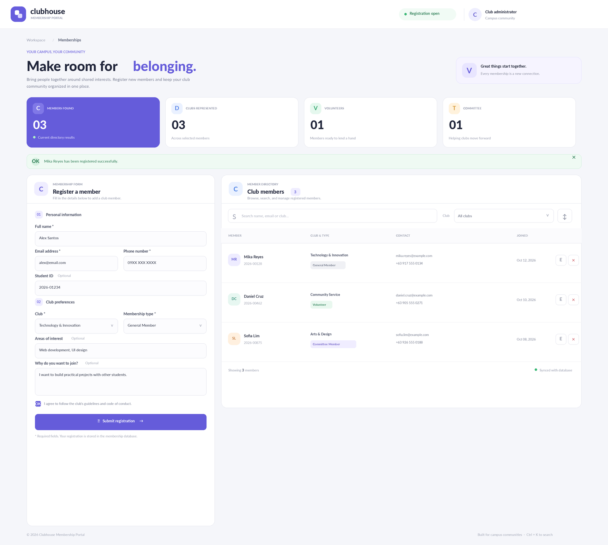
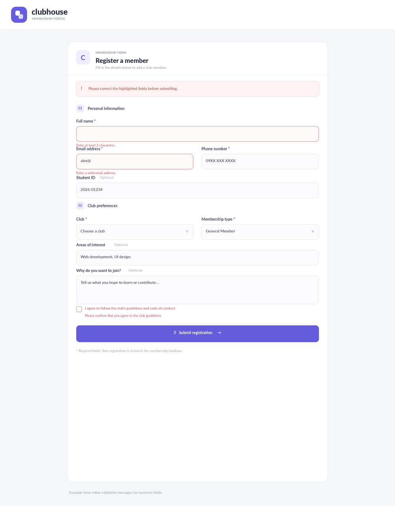
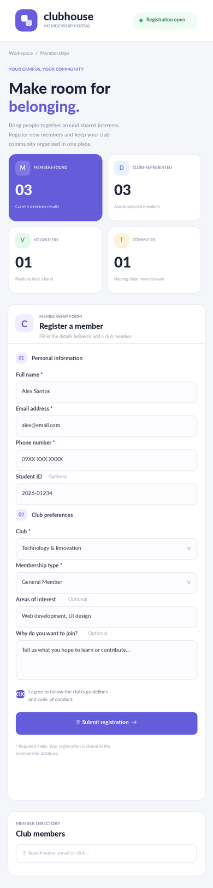

# Clubhouse — Club Membership Registration

A full-stack club membership registration and directory application. A member completes a controlled React form, Axios sends the request to an Express API, the server validates the data, and MySQL stores the record. Saved registrations can be searched, viewed, edited, and deleted.

## Members:
- Laxamana, Karl Kristian Kenneth, N.
- Villanueva, Martin Andrei 
- Mendoza, Chantel Zarah 
- Villajuan, Keannu 

## Tech stack

- **Frontend:** React 19, Vite, TypeScript, Axios, Lucide icons, CSS
- **Backend:** Node.js, Express 4, CORS, dotenv
- **Database:** MySQL 8, `mysql2/promise` connection pool
- **Testing:** Node.js built-in test runner for server-side validation

## Features

- Controlled form fields managed through one state object and one `handleChange` function.
- Field-level client validation and independent server-side validation.
- Inputs include text, email, telephone, select, textarea, and checkbox types.
- Uses `useState`, `useEffect`, `useRef`, a custom `useMembers` hook, and `useReducer` for immutable directory-state updates.
- Initial directory load, loading feedback, API error feedback, and successful-submit confirmation.
- Axios shared instance in `client/src/api/axios.js`; base URL can be set in `client/.env`.
- REST endpoints for listing, viewing, creating, updating, and deleting members.
- Search and club filtering are handled by query parameters in the API.
- MySQL queries are parameterized. Email addresses must be unique.
- Edit and delete actions are available from the directory.
- MySQL uses a Docker volume so records persist when the API or database container restarts.

## Project structure

```text
club-membership-registration/
├── client/
│   ├── src/
│   │   ├── api/axios.js
│   │   ├── components/MemberForm.tsx
│   │   ├── components/MemberTable.tsx
│   │   ├── hooks/useMembers.ts
│   │   ├── App.tsx
│   │   ├── main.tsx
│   │   ├── styles.css
│   │   └── types.ts
│   ├── .env.example
│   └── package.json
├── server/
│   ├── src/middleware/logger.js
│   ├── src/routes/members.js
│   ├── src/validation/member.js
│   ├── src/app.js
│   ├── src/db.js
│   ├── schema.sql
│   ├── test/member.validation.test.js
│   └── .env.example
├── compose.yaml
├── .env.example
└── README.md
```

## Requirements

- Node.js 20.19+ (Node 22 LTS is suitable)
- npm
- Docker Desktop or Docker Engine with Docker Compose

## Setup and run

Open a terminal in the project root. Use two terminals for the client and server after the database is running.

### 1. Start MySQL

Copy `.env.example` to `.env` in the project root. Set a root password and a database-user password. Keep the database password handy because the server's `.env` must use the same value.

```bash
 docker compose up -d db
```

On its first startup, Compose initializes MySQL, creates the `club_membership` database, creates the `members` table, and inserts three sample records from `server/schema.sql`. The `clubhouse-db-data` Docker volume keeps records across container restarts. Initialization SQL only runs automatically for an empty data volume.

Check database status:

```bash
 docker compose ps
```

### 2. Configure and start Express

```bash
cd server
cp .env.example .env
npm install
npm test
npm run dev
```

Edit `server/.env` if needed. `DB_PASSWORD` must match `MYSQL_PASSWORD` in the root `.env`; the default local MySQL port is `3307`. The API runs on `http://localhost:3000` by default.

On Windows PowerShell, use `Copy-Item .env.example .env` instead of `cp` if your shell does not support the alias.

Check the health endpoint in a browser or with curl: `http://localhost:3000/api/health`.

### 3. Configure and start React

Open a new terminal from the project root:

```bash
cd client
cp .env.example .env
npm install
npm run dev
```

The Vite app runs at `http://localhost:5173`. The API base URL is configured in `client/.env` through `VITE_API_URL`; no page component needs its own API URL.

### 4. Build the frontend

```bash
cd client
npm run build
```

The optimized production bundle is written to `client/dist/`.

### 5. Stop services

Stop the MySQL container but keep the database volume:

```bash
docker compose down
```

To remove the local database and its stored registrations completely, run `docker compose down -v`. This permanently deletes local database data.

## API endpoints

All endpoints are prefixed with `/api`. JSON request/response bodies are used.

| Method | Path | Purpose | Success / common errors |
|---|---|---|---|
| GET | `/api/health` | Health check | `200` |
| GET | `/api/members` | List members; optional `search` and `club` query parameters | `200`, `400` |
| GET | `/api/members/:id` | Get one member | `200`, `400`, `404` |
| POST | `/api/members` | Validate and create a member | `201`, `400` |
| PUT | `/api/members/:id` | Validate and update a member | `200`, `400`, `404` |
| DELETE | `/api/members/:id` | Delete a member | `200`, `400`, `404` |

`POST` and `PUT` expect these fields: `fullName`, `email`, `phone`, `studentId`, `club`, `membershipType`, `interests`, `reason`, and `agreeToRules`. The required fields are full name, email, phone, club, membership type, and an affirmative guideline agreement. A duplicate email receives `400` with a field-level validation message.

Example filtered request: `GET /api/members?search=alex&club=Technology%20%26%20Innovation`.

## Screenshots

The images below are UI previews prepared for the README. They were not captured from a live browser session because dependencies could not be installed in this environment. After launching the app locally, replace them with actual browser screenshots if your instructor requires runtime evidence.

### Main dashboard and member directory



### Registration form with validation



### Mobile layout



## Testing

Run server-side validation tests:

```bash
cd server
npm test
```

Run a production TypeScript/Vite build:

```bash
cd client
npm run build
```

The validation tests run without MySQL. End-to-end CRUD operations require the database, server, and client to be running.

## Bonus features included

- `PUT /api/members/:id` update support.
- Search and club filter query parameters on the list endpoint.
- `useReducer` for immutable member-directory state and `useRef` for the search keyboard shortcut (`Ctrl+K` / `Cmd+K`).

React Hook Form/Zod and JWT authentication are not included. The app is intended as a local class project and does not include user login or authorization. Do not expose the server publicly without adding authentication, rate limiting, and production secret management.

## GitHub submission

The project has already been committed and pushed to GitHub.

The repository contains the complete frontend, backend, database schema, Docker Compose configuration, tests, and project documentation.

Environment files containing passwords or other local credentials should remain excluded from the repository. Use the provided .env.example files when setting up the project on another machine.

## Project Status

React registration interface

Client-side validation

Express REST API

Server-side validation

MySQL database storage

Dockerized database environment

Member search and filtering

Member editing and deletion

Persistent database storage

Server-side tests

Production frontend build

GitHub repository and project documentation
